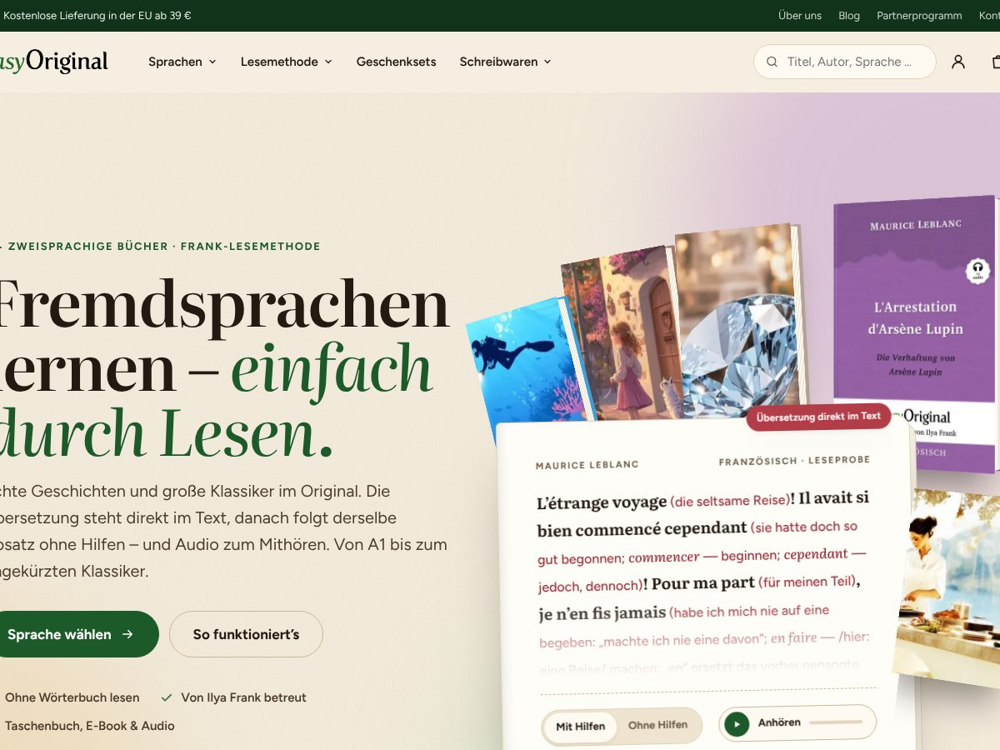

# easyOriginal 2026: дочерняя тема для Divi 4

Тема переносит новый дизайн на рабочий сайт на WordPress + Divi 4 + WooCommerce. В ней сразу **три варианта оформления**, переключаются в настройках:

| Вариант | Как выглядит |
|---|---|
| **A · Buchhandlung** | Тёплая бумага, объёмные 3D-книги, деревянная полка с корешками, фоны в цвет обложек |
| **B · Journal** | Литературный журнал: изумруд, бордо и золото, шрифт Cormorant, буквицы, римские номера глав |
| **C · Bunt** | Яркие цвета для каждого языка, наклейки, «пузыри» с приветствиями, бегущая лента обложек |



## Что внутри

- **Своя шапка и подвал**: верхняя полоса, мега-меню «Sprachen», поиск по книгам, корзина со счётчиком, мобильное меню. Пункты меню редактируются в WordPress.
- **Шаблон страницы «easyOriginal Startseite»** — вся новая главная. Блоки заполняются из магазина сами:
  - на первом экране отрывок с переводом, переключатель «с подсказками / без» и аудио;
  - обложки языков;
  - полка с корешками из бестселлеров;
  - вкладки «Бестселлеры / Новинки / Наборы»;
  - последний отзыв на 5 звёзд.
- **Шорткоды для Divi Builder.** Любой блок можно вставить на любую страницу (модуль «Code» или «Text»):
  - `[eo_baustein name="regal"]` — один блок. Имена: `hero`, `stats`, `sprachen`, `laufband`, `methode`, `regal`, `auswahl`, `niveau`, `aktion`, `geschichte`, `stimme`, `faq`, `newsletter`.
  - `[eo_startseite]` — все блоки сразу.
  - `[eo_katalog sprache="en"]` — каталог языка с фильтрами: уровень, серия, поиск, сортировка, «только акции». Подходит для страниц вроде /englisch-lernen/. Вместо языка можно указать `kategorien="slug,slug"`.
  - `[eo_leseprobe produkt="123"]` — отрывок книги с переключателем и аудио.
- **WooCommerce**:
  - новые карточки во всех списках, включая модуль Divi «Shop»;
  - на страницах категорий шапка с цитатой, фильтр по уровню (`?filter_niveau=a1-a2`), поиск и сортировка;
  - на странице книги карточки форматов вместо выпадающего списка;
  - там же блок «Leseprobe» с аудио;
  - на телефоне закреплённая кнопка покупки;
  - диапазоны цен показываются как «ab 6,99 €» (можно выключить).
- **Юридические пометки German Market сохраняются.** Тема вызывает все стандартные хуки WooCommerce, поэтому «inkl. MwSt.», «zzgl. Versand», срок доставки и т. п. остаются.
- **Шрифты загружаются с вашего сервера.** Google Fonts не используется, это важно для GDPR.

## Установка

> ⚠️ Сначала **сделайте резервную копию** и, если хостинг позволяет, проверьте тему на **копии сайта (staging)**. Тема проверена на WordPress 7.1 и WooCommerce 11.2 с имитацией Divi: настоящий Divi — платный продукт, в тестовой среде его не было.

1. **Загрузите тему.** «Design → Themes → Theme hochladen» → файл `easyoriginal-divi-1.0.0.zip` (лежит в папке `dist/` репозитория) → «Aktivieren». Divi должен оставаться установленным: это родительская тема.
2. **Ваша нынешняя тема Divi-Child.** Её сделала Multimediana, и в её `functions.php` / `style.css` может быть собственный код. Перед переключением сравните этот код и перенесите нужное в конец `style.css` или `functions.php` новой темы.
3. **Отключите шапку и подвал в Theme Builder.** «Divi → Theme Builder» → шаблон «Default Website Template» → у Global Header и Global Footer нажмите на значок глаза (выключить). Иначе Divi покажет старую шапку вместо новой.
4. **Главная страница.** Откройте страницу главной → справа «Seiten-Attribute → Template» → **easyOriginal Startseite** → «Aktualisieren». Если на странице был контент из Divi Builder, он появится под новыми блоками. Можно удалить его или оставить.
5. **Меню.** «Design → Menüs»:
   - Тема добавляет позиции: «Hauptmenü», «Servicelinks oben», четыре колонки подвала.
   - Пока меню не назначены, используются готовые меню со ссылками на ваши текущие страницы.
   - Мега-меню: у пункта верхнего уровня (например «Sprachen») включите в «Ansicht-Optionen» поле «CSS-Klassen» и впишите `eo-mega`.
   - Подпункты с классами `lang-en`, `lang-fr`, `lang-it`, `lang-es`, `lang-ru`, `lang-de` получат цвет и метку языка.
6. **Вариант и тексты.** «Design → Customizer → easyOriginal»:
   - Выберите вариант A, B или C.
   - Пока вы вошли как администратор, внизу страницы есть переключатель «Variante». Через него все три варианта можно сравнить прямо на своём сайте, посетители его не видят.
   - Там же правятся все тексты главной, вопросы-ответы, акция (сейчас «Weihnachten in Spanien») и ссылки на страницы языков.
7. **Рассылка.** Нынешняя форма подписки — модуль Divi «E-Mail-Optin» в подвале Theme Builder. Сохраните её в Divi-Bibliothek как глобальный модуль. Затем вставьте шорткод `[et_pb_section global_module="ID"][/et_pb_section]` в Customizer → «Startseite: Bausteine → Newsletter – Shortcode». Без шорткода блок рассылки скрыт.

## Отрывок книги (Leseprobe) на странице товара

В редакторе товара есть блок **easyOriginal**:

| Поле | Что вписать |
|---|---|
| Deutscher Titel | немецкое название, если оно не идёт в названии товара после «/» или «—» |
| Autor | автор (если пусто — тема пытается угадать по имени файла обложки) |
| **Leseprobe im Frank-Format** | текст как в книге: перевод в круглых скобках сразу после слова |
| Audio | ссылка на MP3, например `https://easyoriginal1.s3.eu-central-1.amazonaws.com/franzoesisch/f1/1.mp3` |
| Leseprobe-PDF | ссылка на PDF с отрывком |
| Cover-Farbe | необязательно: цвет обложки. Если пусто, тема определит его по картинке сама |

Пример текста для поля Leseprobe:

```
L’étrange voyage (die seltsame Reise)! Il avait si bien commencé cependant (sie hatte doch so gut begonnen; commencer — beginnen; cependant — jedoch, dennoch)!
```

- Тема сама выделит перевод цветом.
- Слова вида «commencer — beginnen» она сделает курсивом.
- Абзац «без подсказок» тема соберёт автоматически.

Отрывок на первом экране главной берётся из товара с артикулом **DF1** (Arsène Lupin) или из того, что указано в Customizer. Если у товара отрывка нет, показывается встроенный отрывок из Lupin.

## Уровни и языки

- **Уровень книги** берётся по порядку:
  1. из атрибута `pa_niveau` (значения `a1-a2`, `a2-b1`, `b1-b2`, `original`);
  2. если его нет — из названия («… A1-A2»);
  3. если и там нет — из slug категории («…-a1-a2», «modern-…-frank» = A2–B1, «englisch-deutsch» = Original).

  Чтобы работал фильтр по уровню в категориях, создайте атрибут **Niveau** («Produkte → Eigenschaften») и проставьте его книгам.
- **Язык** определяется по атрибуту `pa_sprache` или по slug категорий (`englisch`, `franzoesisch`, `italienisch`, `spanisch`, `russisch`, `deutsch-englisch`). Какие категории относятся к языку, задаётся в Customizer → «Sprachen». Там уже вписаны slug из вашего магазина.

## Что проверено

- **Тестовый сайт:** WordPress 7.1 (de_DE), WooCommerce 11.2 и 146 ваших товаров: обложки, цены, варианты форматов и отзыв.
- **Страницы:** главная, магазин, категория, товар, корзина — все отдают HTTP 200, ошибок PHP нет.
- **Автотест в браузере — 19 из 19:**
  - выбор формата → цена 20,99 € → «In den Warenkorb» → счётчик корзины = 1;
  - фильтр уровня в категории (110 → 10 книг);
  - каталог-шорткод (110 → 69 → 22 по «austen»);
  - вкладки, мега-меню, мобильное меню;
  - нет горизонтальной прокрутки, нет ошибок JS.
- **Совместимость с Divi** проверена на типичных глобальных правилах Divi 4: шрифты, заголовки, `.container`, `#main-content`, сетка WooCommerce, кнопки. Сам Divi в тест не входил, поэтому после установки на staging пройдитесь глазами по главной, категории, товару, корзине и оформлению заказа.

## Файлы

```
easyoriginal-divi/
├── style.css, functions.php, header.php, footer.php
├── page-templates/startseite.php      шаблон главной
├── woocommerce/content-product.php    карточка товара в списках
├── template-parts/sprite.php          иконки
├── inc/
│   ├── setup.php        стили/скрипты, вариант, меню, совместимость с Divi
│   ├── customizer.php   настройки и тексты по умолчанию
│   ├── nav.php          меню, мега-меню, меню по умолчанию
│   ├── home.php         блоки главной, Leseprobe, каталог, шорткоды
│   ├── woocommerce.php  магазин: карточки, категории, товар
│   ├── metabox.php      поля «easyOriginal» у товара
│   └── helpers.php      название/язык/уровень/автор, цвет обложки, карточка
└── assets/              css (base, skin-*, wp), js, шрифты, логотип
```

Стили `base.css` и `skin-*.css` — те же, что в прототипе (`../easyoriginal-redesign/`). Если меняете дизайн в прототипе, скопируйте эти файлы сюда.

Чтобы пересобрать ZIP для загрузки:

```bash
cd /path/to/news_field && rm -f dist/easyoriginal-divi-*.zip && zip -rq dist/easyoriginal-divi-1.0.0.zip easyoriginal-divi -x "*.DS_Store"
```
