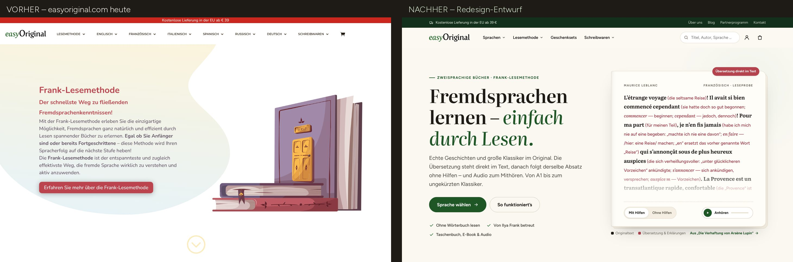

# easyOriginal: redesign of easyoriginal.com

A working prototype of the new site design. It has three key pages: the **homepage**, a **language catalog** (English) and a **product page** (*L'Arrestation d'Arsène Lupin*). Everything is built on real content from easyoriginal.com: titles, prices, covers, the Frank-method sample text and the audio.



## How to view

Open `index.html` in a browser (a double-click is enough). Or start a local server:

```bash
cd easyoriginal-redesign && python3 -m http.server 8000
```

Then go to <http://localhost:8000>.

The pages are linked to each other. Links to sections that haven't been redesigned lead to the live easyoriginal.com.

| Page | File | What to try |
|---|---|---|
| Homepage | `index.html` | the "Mit Hilfen / Ohne Hilfen" toggle and the "Anhören" button in the first screen; the Bestseller / Neu / Sets tabs; the "Sprachen" menu |
| English catalog | `englisch-lernen.html` | level filter, series, search ("austen"), sorting, "Nur Angebote"; filters are saved in the URL (`?niveau=A1–A2`) |
| Product page | `produkt-arsene-lupin.html` | format choice (the price changes), quantity, "In den Warenkorb", the sample page, the sticky buy bar on mobile |

---

## What changed and why

| Problem on the current site | Solution in the redesign |
|---|---|
| The first screen shows a stock picture of books and generic promises ("der schnellste Weg…"). The main selling point, what a Frank-method page looks like, isn't visible. | **The first screen shows the method itself**: a real page from "Arsène Lupin" with the translation inside the text, a toggle to the plain original, and the real audio recording. Visitors understand the product in five seconds. |
| 8 top-level menu items; "Deutsch" and "Schreibwaren" link to `#` (dead links); menu items are in capitals. | **4 items**: Sprachen (a mega menu with all languages and series), Lesemethode, Geschenksets, Schreibwaren. Plus a search box, account and cart. On mobile there's a separate slide-out menu. |
| Covers load as placeholders, and the page is full of empty white gaps. | Each card has a fixed-proportion slot, so nothing jumps around. Covers sit on a soft "plinth" with a shadow, like books on a shelf. Images were converted to WebP (14 MB → 3.7 MB). |
| Three long carousels in a row (Sets, New, Bestsellers) with the same cards. | **One shelf with tabs**: Bestseller / Neu / Bücher-Sets. |
| A long, repetitive SEO text on the homepage ("revolutionär", "Sprachgefühl"…). | It's condensed into **3 method steps**, an honest note ("a book won't teach you to speak, but…") and an **FAQ**. The SEO text on catalog pages moves into a collapsible block. |
| Learners can't tell which book fits their level. | A **"Welches Niveau passt zu Ihnen?"** section (A1–A2 → A2–B1 → B1–B2 → Original) with a difficulty bar. In the catalog there's a **level filter** with counts, a series filter, search and sorting. |
| Titles are one long line ("The Roaming Rocks — Die wandernden Steine A1-A2"). | Titles are split: **the original** in serif, **the German translation** as a subtitle, the level as a label, and the author for classics. |
| On the product page, format is a dropdown with 5 options, the price is a range, and the sample text is hidden in the description. | **Format cards** (paperback / with CD / e-book plus file type) where the price updates instantly. A large "In den Warenkorb" button, a **sticky buy bar on mobile**, a **"Leseprobe" section** with audio, a bundle upsell and a specs table. |
| Little trust: no founder story, no reviews on the homepage. | **"Unsere Geschichte"**: a quote from Anastasia Guskova, Ilya Frank's involvement, an Austrian publisher. Plus a real reader review. |
| The cookie banner uses "du" while the site uses "Sie", and shows unfilled placeholders (`{title}`, `{vendor_count}`). | A short, consistent banner using "Sie", with **equal-weight** "Alle akzeptieren" and "Nur notwendige" buttons. |
| Fonts: Nunito, Montserrat, Poppins, Libre Baskerville, Open Sans, Charis (6 typefaces). | **2 typefaces**: Literata (a book serif made for long reading, with Cyrillic support) and Figtree (interface). **Fonts are hosted locally**: loading Google Fonts from Google's servers has been found to violate GDPR (LG München, 2022). |

## Design system

**Concept: "reading in the original, with a friend in the margins".** Warm paper, black text, and red "margin notes" for translations, the way a teacher writes in red pen. Green comes from the logo ("easy") and becomes the main brand colour.

| Token | Colour | Use |
|---|---|---|
| `--paper` | `#fbf8f2` | page background |
| `--ink` | `#1e1b17` | text |
| `--green-700` | `#1f5626` | buttons, links, accents (from the logo `#266b2a`) |
| `--green-900/950` | `#12301b` / `#0d2214` | top bar, "Geschichte" block, footer |
| `--rose-700` | `#9e3440` | translations in sample text, "Set-Preis" labels, Christmas block |
| `--gold-600` | `#a87a3d` | stars, notes |
| `--lang-en/fr/it/es/ru/de` | blue / violet / olive / terracotta / burgundy / graphite | language colour codes (labels, card stripes) |

- **Typography:** headings and book text in Literata (with an optical-size axis); UI, buttons and prices in Figtree. Sizes use `clamp()` and scale smoothly from phone to desktop.
- **Components:** product card, shelf with tabs, "book page" with the Frank toggle and audio, language card, level card, format cards, FAQ, newsletter, mega menu, mobile menu, toast, cookie banner.
- **Accessibility:** contrast ≥ 4.5:1, visible focus, a "Zum Inhalt springen" skip link, menus and filters work from the keyboard (Esc closes them), `lang` attributes on foreign-language text (screen readers pronounce French as French), and `prefers-reduced-motion` is respected.
- **Responsive:** checked at 360, 390, 768, 1024, 1280 and 1440 px with no horizontal scrolling.

All tokens are at the top of `assets/css/styles.css`, so changing a colour or font means changing one line.

## Files

```
easyoriginal-redesign/
├── index.html, englisch-lernen.html, produkt-arsene-lupin.html   ← finished pages (generated)
├── _src/                      ← page sources; edit these
│   ├── *.html
│   └── partials/header.html, footer.html   ← shared header and footer
├── build.py                   ← assembles the pages: python3 build.py
├── assets/
│   ├── css/styles.css         ← design tokens and all styles
│   ├── css/fonts.css          ← local fonts
│   ├── js/main.js             ← menu, shelf, filters, formats, cart (demo)
│   ├── js/data.js             ← product data (110 English titles + homepage shelves)
│   ├── fonts/  img/  covers/
└── docs/screenshots/          ← before / after screenshots
```

After editing `_src/`, run `python3 build.py`. The header and footer are stored once and get inserted into every page.

## Moving it to WordPress / WooCommerce

The site currently runs on WordPress + Divi + WooCommerce (with German Market and BeRocket filters). There are two routes:

1. **Within Divi** (faster). Add the tokens and component styles from `styles.css` to the child theme (`Divi-Child/style.css`), connect the fonts from `assets/fonts`, and rebuild the header/footer in the Divi Theme Builder using the mockup. The homepage hero with the sample text is a code module containing the HTML from `index.html`.
2. **A lightweight block theme** (better for speed and Core Web Vitals). For example Blocksy or Kadence plus your own WooCommerce templates. Divi produces heavy markup.

Either way, for the shop features:
- **Level** → product attribute `pa_niveau` (A1–A2, A2–B1, B1–B2, Original). The level filter is then built with the existing BeRocket AJAX Filters.
- **German subtitle and author** → separate fields (an ACF field or the attributes `pa_autor` and `untertitel_de`) instead of putting them in the title.
- **Format cards** → the variation attribute `pa_buch-ebook` already exists. It only needs to be displayed as cards (for example with the WPC Variations Radio Buttons plugin already installed, plus the CSS from the mockup).
- **Frank sample text** → the same HTML structure (`<span class="o">` original, `<span class="g">` translation) in a product field. The toggle and audio come from `main.js`.

## Please check before launch

This is a design mockup, not a live shop. A few points need your eye:

- **Copy I wrote:** the hero, step descriptions, level descriptions, FAQ answers and the "Christmas in Spain" block. I wrote them from your site's content, but please check the claims: "zu vielen Büchern gibt es Audio", "Von Ilya Frank betreut", "seit 2020", and the difference between "Frank-Lesemethode" and "mit Worterklärungen".
- **Language cards:** for English, French and Russian I used opening lines from books in your catalogue. For Italian, Spanish and German I used the neutral "Once upon a time…" because I didn't know the right opening line from your books. It's easy to swap in a line from your own book.
- **Glosses in the homepage hero** are slightly shortened to fit the screen. The product page shows the text in full, exactly as on the site.
- **The reader review** (Laura Köhler) is quoted with obvious typos corrected ("dass" → "das").
- **Prices and the catalogue** are a snapshot from easyoriginal.com as of November 2026. Only the English catalogue is built with filters; the other languages link to the live site.
- **The cart, newsletter and cookie banner** are demos. They don't send anything anywhere (the counter is stored in the browser). The audio streams from your S3 storage.
- The developer credit line in the footer ("Webdesign & Webentwicklung – Multimediana") is left out of the mockup. Whether to keep it depends on who builds the new design.
