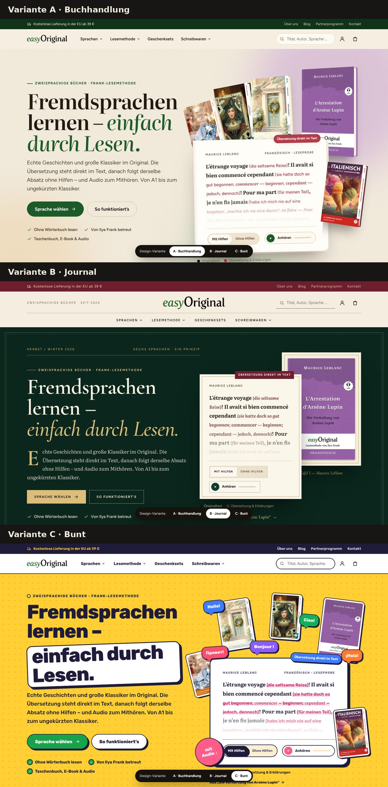

# easyOriginal: редизайн easyoriginal.com — три варианта

Рабочий прототип нового дизайна: **главная**, **каталог языка** (английский) и **страница книги** (*L'Arrestation d'Arsène Lupin*). Каждую страницу можно посмотреть в **трёх вариантах**. Весь контент настоящий, с easyoriginal.com: названия, цены, 170 обложек, отрывок по методу Франка, аудио.

Готовая тема для WordPress/Divi 4 с этими же тремя вариантами лежит в [`../easyoriginal-divi/`](../easyoriginal-divi/README.md).



## Как посмотреть

Откройте `index.html` в браузере. Или запустите локальный сервер:

```bash
cd easyoriginal-redesign && python3 -m http.server 8000
```

После этого откройте <http://localhost:8000>.

**Переключатель вариантов** — чёрная плашка внизу экрана: **A · Buchhandlung**, **B · Journal**, **C · Bunt**.

- Выбор запоминается в браузере и сохраняется при переходе между страницами.
- Вариант можно задать ссылкой: `index.html?v=journal`, `produkt-arsene-lupin.html?v=bunt`.

| Страница | Файл | Что попробовать |
|---|---|---|
| Главная | `index.html` | «Mit Hilfen / Ohne Hilfen» и «Anhören» на первом экране; полка с корешками (наведите на книгу, в вариантах A и B); вкладки «Bestseller / Neu / Bücher-Sets»; меню «Sprachen» |
| Каталог английского | `englisch-lernen.html` | фильтр уровня, серии, поиск («austen»), сортировка; фильтры сохраняются в ссылке |
| Страница книги | `produkt-arsene-lupin.html` | выбор формата (цена меняется), «In den Warenkorb», Leseprobe с аудио, закреплённая кнопка покупки на телефоне |

## Три варианта

| | A · Buchhandlung | B · Journal | C · Bunt |
|---|---|---|---|
| Настроение | дорогой книжный магазин | литературный журнал | яркое, игровое, как языковые приложения |
| Цвета | бумага с зерном, зелёный из логотипа, ягодный | изумруд, бордо, золото | жёлтый, розовый, синий, фиолетовый; свой цвет у каждого языка |
| Шрифты | Literata + Figtree | Cormorant Garamond + Literata | Rubik + Literata |
| Первый экран | веер из 3D-книг, поверх страница из «Lupin» | тёмный «титульный лист», обложка в золотой раме, буквица | книги-наклейки, пузыри с «Hello! / Bonjour ! / Привет!», стикер «mit Audio» |
| Языки | карточки с веером обложек | оглавление с римскими номерами | цветные плитки |
| Особый блок | деревянная полка с корешками в цвет обложек | библиотечная полка с золотым тиснением | бегущая лента обложек |
| Уровни | «лестница» | таблица с ромбами ◆◇ | игровые уровни со звёздами ★ |

Варианты целиком (длинные скриншоты): [A](docs/screenshots/variante-buch-komplett.jpg) · [B](docs/screenshots/variante-journal-komplett.jpg) · [C](docs/screenshots/variante-bunt-komplett.jpg) · [мобильная версия](docs/screenshots/varianten-mobil.jpg) · [до/после](docs/screenshots/vorher-nachher.jpg)

## Что изменилось по сравнению с нынешним сайтом

- **Первый экран показывает сам метод.** Вместо картинки с книгами — настоящая страница из «Арсена Люпена»: перевод прямо в тексте, переключатель на чистый оригинал и аудио.
- **Меню короче.** Четыре пункта вместо восьми, мега-меню по языкам, битые ссылки `#` у «Deutsch» и «Schreibwaren» исправлены.
- **Обложки как книги.** У каждой книги свой цвет: он вычислен по обложке и используется для фона карточки и корешка на полке. Пустых мест из-за ленивой загрузки больше нет. Картинки переведены в WebP.
- **Видно уровень.** Есть блок «Какой уровень вам подходит», а в каталоге — фильтр по уровню, серии, поиск и сортировка.
- **Название разделено на два.** Оригинал крупно, немецкий перевод — подзаголовком, рядом уровень, у классики автор.
- **Удобная страница книги.** Форматы — карточками, цена меняется сразу, Leseprobe с аудио, на телефоне закреплённая кнопка покупки.
- **Больше доверия.** Цитата основательницы, участие Ильи Франка, настоящий отзыв читательницы.
- **Порядок в мелочах.** Везде на «Sie», баннер cookies с равнозначными кнопками, шрифты грузятся со своего сервера (GDPR), доступность: контраст, фокус, клавиатура, `lang` у иностранного текста.

## Файлы

```
easyoriginal-redesign/
├── index.html, englisch-lernen.html, produkt-arsene-lupin.html   ← готовые страницы (собираются)
├── _src/                       ← исходники страниц, редактировать здесь
│   └── partials/head.html, header.html, footer.html
├── build.py                    ← сборка: python3 build.py
├── assets/
│   ├── css/base.css            ← структура всех компонентов
│   ├── css/skin-buch.css       ← вариант A
│   ├── css/skin-journal.css    ← вариант B
│   ├── css/skin-bunt.css       ← вариант C
│   ├── css/fonts.css           ← локальные шрифты (Literata, Figtree, Cormorant Garamond, Rubik)
│   ├── js/main.js              ← меню, полки, фильтры, форматы, переключатель вариантов
│   ├── js/data.js              ← данные товаров и цвета обложек
│   └── fonts/  img/  covers/
└── docs/screenshots/
```

Вариант задаётся атрибутом `<html data-skin="buch|journal|bunt">`. Всё оформление варианта лежит в его `skin-*.css`.

## Проверьте, пожалуйста, перед запуском

- **Тексты, которые написала я:** первый экран, шаги метода, описания уровней, вопросы-ответы, рождественский блок. Особенно утверждения «аудио есть у многих книг», «с 2020 года», «Von Ilya Frank betreut».
- **Строки в карточках языков.** Для английского, французского и русского взяты первые строки ваших книг: Диккенс, Леблан, Чехов. Для итальянского, испанского и немецкого — нейтральное «Жили-были…»; его легко заменить строкой из своей книги.
- **Отзыв Laura Köhler** приведён с исправленными явными опечатками.
- **Цены и каталог** — снимок easyoriginal.com на ноябрь 2026. Каталог с фильтрами в прототипе сделан для английского. В теме WordPress он работает для любого языка: шорткод `[eo_katalog sprache="fr"]`.
- **Корзина, рассылка и баннер cookies** в прототипе — демонстрация, никуда ничего не отправляют.
